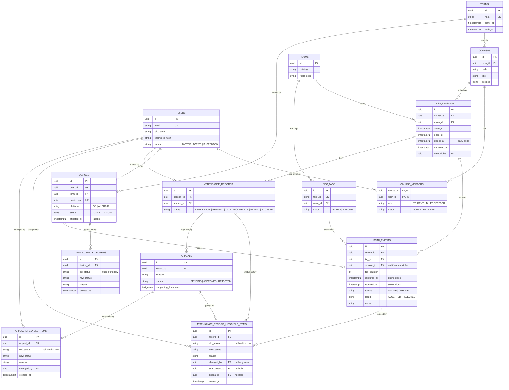

# Data model

Approved ER diagram. Each table belongs to one module and lives in that module's Postgres
schema (see `docs/architecture.md`). References across modules are plain IDs.

Every table also has `created_at` and `updated_at` (`timestamptz`), except the two
lifecycle tables below, which are append-only and have only `created_at`:
`device_lifecycle_items` and `attendance_record_lifecycle_items`.



Foreign key lines that cross a module boundary in the picture are **IDs only** in the
database (rule 6 in `docs/architecture.md`).

## Constraints

| Table | Constraint |
|---|---|
| `devices` | Unique `(user_id, term_id)` where status is ACTIVE: one phone per account per term. Rebinding needs the latest device to be at least 7 days old. |
| `scan_events` | Unique `(device_id, tag_id, tag_counter)`, and unique `(tag_id, tag_counter)` where result is ACCEPTED |
| `class_sessions` | `ends_at > starts_at`. No overlap per room among sessions with `cancelled_at` null. |
| `attendance_records` | Unique `(session_id, student_id)` |
| `appeals` | At most one PENDING appeal per record; a student may appeal again after a rejection |
| record lifecycle items | At most one of `scan_event_id` and `appeal_id` is set; a manual change needs `changed_by` |
| all lifecycle items | `new_status` differs from `old_status` |

## Derived values (not stored)

Session state comes from time, not a column:

```
CANCELLED  if cancelled_at is not null
CLOSED     if closed_at is not null, or now >= ends_at
OPEN       if now is between starts_at and coalesce(closed_at, ends_at)
SCHEDULED  otherwise
```

## Course policy (`courses.policies`)

```json
{ "late_after_minutes": 10, "absent_after_minutes": 30,
  "require_checkout": true, "earliest_checkout_after_minutes": 45 }
```

Policies cannot be changed while a session of the course is OPEN.

## Attendance status flow

| Event | Without checkout | With checkout |
|---|---|---|
| First tap | PRESENT or LATE | CHECKED_IN |
| Second tap | not applicable | PRESENT or LATE |
| Session ends still CHECKED_IN | not applicable | INCOMPLETE |
| No tap | ABSENT | ABSENT |
| Manual change or approved appeal | any status, with a reason | same |
